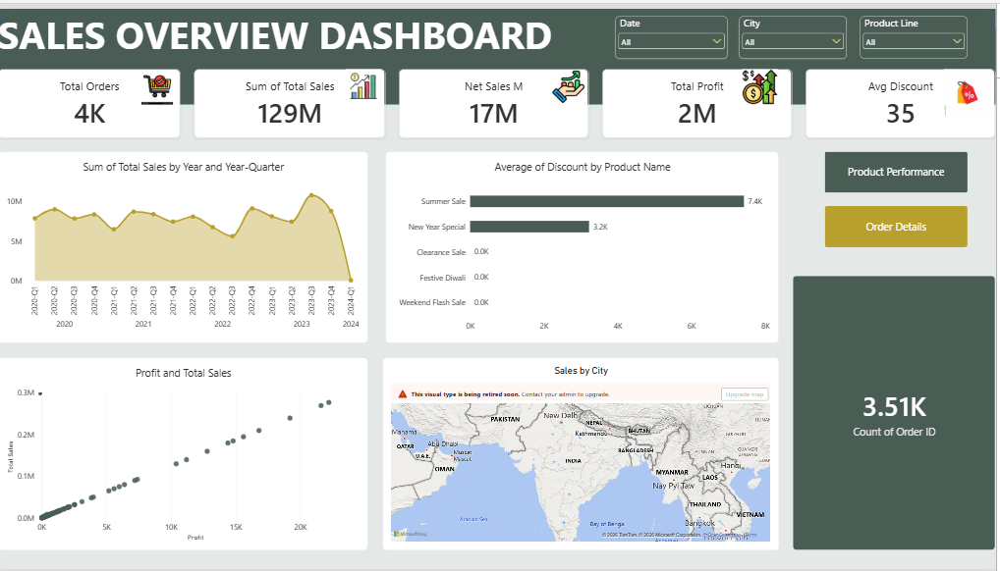
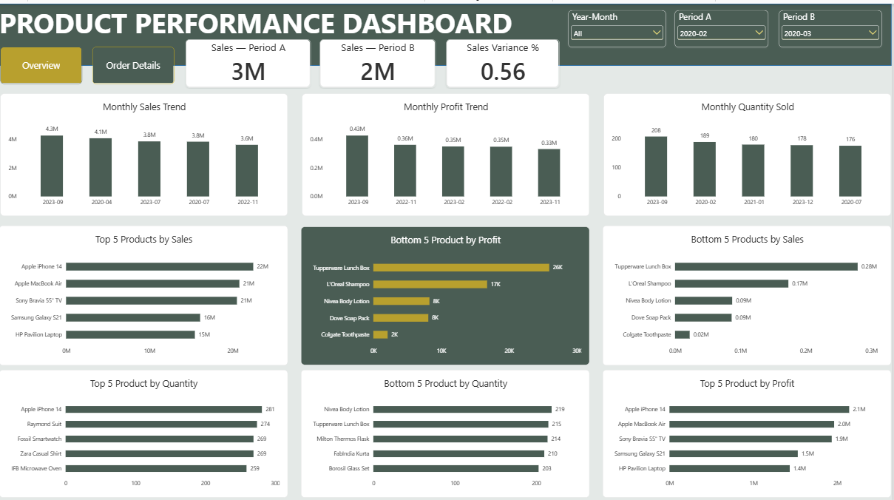
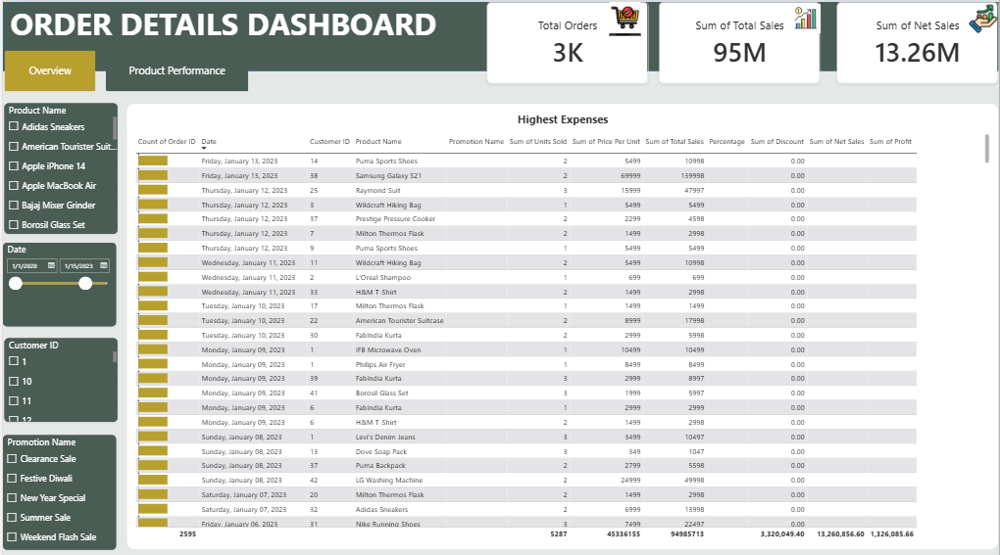

# DAC-Datastore-PowerBI-Dashboard

An interactive three-page Power BI dashboard built for D.A.C Datastore, an offline retail store, as the Week 4 project of the Project Builders data analysis training. It turns raw transaction data into answers store management can act on: which products perform best and worst, how sales move over time, how discounts affect revenue, and where customers buy from.

## Project overview

The store sells products across eight categories: Electronics, Footwear, Clothing, Home Appliances, Accessories, Kitchenware, Bags and Personal Care. Management needed one report to monitor sales performance, compare time periods and look up individual orders. This project covers the full workflow: cleaning and shaping the data in Power Query, building a star-schema data model, writing calculations and DAX measures, and designing the dashboard.

## Business questions answered

| # | Question | Where to find it |
|---|---|---|
| 1 | Top and bottom 5 products by sales, profit and quantity sold | Product Performance |
| 2 | How do sales trends vary daily, monthly, quarterly and annually? | Sales Overview |
| 3 | What is the relationship between sales and profit? | Sales Overview |
| 4 | How do sales, profit and quantity compare between any two selected periods? | Product Performance |
| 5 | What is the average discount in each discount category? | Sales Overview |
| 6 | What is the total number of orders? | Sales Overview |
| 7 | What are the sales, profit, discount and net sales of each order, filterable by product, date, customer and promotion? | Order Details |
| 8 | How do sales differ by city? | Sales Overview |

## Dashboard pages

### 1. Sales Overview
Headline cards (total orders, total sales, net sales, total profit and average discount), a drill-down line chart that moves from year to quarter, month and day, a map of sales by city, a sales vs profit scatter plot with a trend line, and a chart of average discount by promotion.



### 2. Product Performance
Six bar charts showing the top 5 and bottom 5 products by sales, profit and units sold. A period comparison section uses two slicers (Period A and Period B) to compare sales, profit and quantity between any two months, with variance and variance percentage.



### 3. Order Details
A detailed order table with Order ID, date, customer, product, promotion, units sold, price per unit, total sales, discount, net sales and profit, filtered by slicers for product, date, customer ID and promotion.



## Dataset

The Excel workbook (`Store_Data.xlsx`) contains four tables arranged as a star schema:

| Table | Type | Contents |
|---|---|---|
| Dim Customer | Dimension | 50 customers: ID, name, city, state, pincode, email, phone |
| Dim Product | Dimension | 30 products across 8 categories, with base prices in INR |
| Dim Promotion | Dimension | 5 promotional campaigns and their discount structures |
| Fact table | Fact | 3,510 sales transactions from 2020 to 2024: date, customer, promotion, product and units sold |

## Data preparation (Power Query)

- Renamed the sales sheet to `Fact table` and added an `Order ID` index column.
- Set `Customer ID`, `Product ID` and `Promotion ID` to Text so relationships match.
- Renamed `Price (INR)` to `Price Per Unit`.
- Promoted the first row to headers in Dim Promotion and created a `percentage` column from the promotion type (20, 10, 50 and 70 percent, with Buy 1 Get 1 Free as 50 percent).
- Merged the fact table with Dim Product and Dim Promotion to bring in price and discount percentage.
- Created calculated columns:
  - `Total Sales` = Units Sold × Price Per Unit
  - `Discount Value` = Total Sales × percentage ÷ 100
  - `Net Sales` = Total Sales − Discount Value
  - `Profit` = 10% of Net Sales
- Handled null values for orders placed without a promotion so Net Sales equals Total Sales for those rows.

## Data model

Relationships (one-to-many, single direction):

- `Dim Customer[Customer ID]` → `Fact table[Customer ID]`
- `Dim Product[Product ID]` → `Fact table[Product ID]`
- `Dim Promotion[Promotion ID]` → `Fact table[Promotion ID]`
- `Calendar[Date]` → `Fact table[Date]`

A Calendar table provides Year, Quarter, Month and Year-Month fields for time analysis and period comparison.

## DAX measures

- Total Sales, Net Sales, Total Profit, Total Quantity, Total Orders, Average Discount
- Period comparison using `CALCULATE` and `TREATAS` with two disconnected period tables:
  - Sales A / Sales B, Profit A / Profit B, Quantity A / Quantity B
  - Variance and Variance % for each metric

## Assumptions

- **Profit** is calculated as 10% of Net Sales, because the dataset has no cost column.
- **Buy 1 Get 1 Free** is treated as a 50% effective discount.
- Orders with no promotion are treated as having a 0% discount.
- Each row in the fact table is counted as one order, because the dataset has no order ID.

## Key insights

- Top products by sales: `[product names]`
- Bottom products by sales: `[product names]`
- Best-performing month or quarter: `[period and figure]`
- Highest-selling city: `[city and figure]`
- Discount impact: `[what you noticed, e.g. which promotion has the highest average discount]`
- Sales vs profit: `[what the scatter plot shows]`

## Tools used

Power BI Desktop, Power Query, DAX and Microsoft Excel.

## Repository contents

```
[Power BI File](DAC_Datastore_Dashboard.pbix)
[Datase](Store_Data.xlsx)
├── screenshots/
[Page1](sales-overview.png)
[Page2](product-performance.png)
[Page3](order-details.png)
└── README.md
```

## How to use

1. Download `DAC_Datastore_Dashboard.pbix`.
2. Open it in Power BI Desktop.
3. Use the slicers on each page to filter the data.


**Badejo Eniola Peace** – Microbiologist and QA/QC professional building data analytics skills.
Connect with me on LinkedIn: `[your LinkedIn link]`
